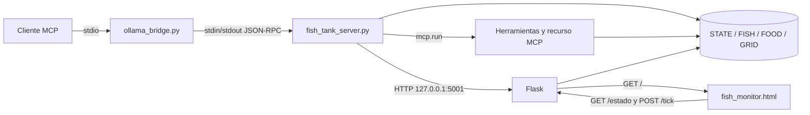

# Arquitectura actual

## Alcance

Este documento describe los componentes verificables del repositorio y sus
interfaces. La aplicación está concentrada en `mcp/`; no se encontraron
archivos de pruebas ni un archivo de dependencias en el inventario revisado.
Los hallazgos de seguridad estática están documentados en
[Auditoría de seguridad](auditoria-seguridad.md).

## Componentes y responsabilidades

| Componente | Responsabilidad | Evidencia |
|---|---|---|
| `mcp/fish_tank_server.py` | Mantiene el estado global, ejecuta la simulación, expone el recurso y las herramientas MCP y sirve el monitor mediante Flask. | Inicialización de `MCPServer`, Flask y el estado: `mcp/fish_tank_server.py:17-43`; recurso y herramientas: `mcp/fish_tank_server.py:279-434`; arranque: `mcp/fish_tank_server.py:458-474`. |
| Estado de simulación | Agrupa agua/equipos/reloj en `STATE`, el pez en `FISH`, alimento en `FOOD` y la geometría en `GRID`; `lock` protege las lecturas y escrituras concurrentes. | `mcp/fish_tank_server.py:17-43`. |
| Motor de simulación | Avanza el reloj, temperatura, calidad del agua, salud, alimento y movimiento del pez en cada tick. | `mcp/fish_tank_server.py:106-278`. |
| Flask | Sirve `fish_monitor.html`, devuelve un snapshot sin caché y ejecuta un tick por `POST`. Escucha en `127.0.0.1:5001` cuando se ejecuta el servidor principal. | `mcp/fish_tank_server.py:434-456`; `mcp/fish_tank_server.py:458-474`. |
| `mcp/fish_monitor.html` | Renderiza el tanque y los indicadores en el navegador; solicita ticks y sondea el snapshot. | `mcp/fish_monitor.html:234-425` y `mcp/fish_monitor.html:451-497`. |
| Servidor MCP | Publica el recurso `pecera://estado` y las operaciones de consulta y modificación decoradas con `@mcp.tool()`. | `mcp/fish_tank_server.py:279-434`. |
| `mcp/ollama_bridge.py` | Expone dos herramientas MCP de puente, consulta Ollama, valida una única acción permitida y la ejecuta en un proceso hijo de `fish_tank_server.py` por JSON-RPC sobre stdin/stdout. | Configuración y proceso hijo: `mcp/ollama_bridge.py:48-106`; protocolo: `mcp/ollama_bridge.py:145-186`; ejecución validada: `mcp/ollama_bridge.py:198-225` y `mcp/ollama_bridge.py:330-374`. |

## Interfaces y puntos de entrada

### Monitor HTTP

- `GET /` devuelve el archivo `fish_monitor.html` desde el directorio del
  servidor (`mcp/fish_tank_server.py:434-436`).
- `GET /estado` serializa `crear_snapshot()` como JSON y establece cabeceras
  de no caché (`mcp/fish_tank_server.py:439-445`).
- `POST /tick` llama a `tick_simulation()` y responde `{"ok": true}`
  (`mcp/fish_tank_server.py:447-450`).

### MCP

El servidor define el recurso `pecera://estado`
(`mcp/fish_tank_server.py:279-284`) y estas herramientas:

`leer_sensores`, `alimentar`, `cambiar_temperatura`,
`encender_apagar_luz`, `limpiar_filtro`, `cambiar_agua`,
`verificar_salud_peces`, `activar_desactivar_filtro`,
`medir_calidad_agua`, `agregar_tratamiento` y `activar_auto_cuidar`.
Las definiciones y sus validaciones de dominio están en
`mcp/fish_tank_server.py:286-432`.

El puente publica `pecera_ollama_bridge` y
`alimentar_con_ollama` (`mcp/ollama_bridge.py:360-370`). El archivo
`.vscode/mcp.json` lo registra como servidor `stdio`, ejecutando Python con
`mcp/ollama_bridge.py` (`.vscode/mcp.json:2-8`).

## Arranque y concurrencia

Al ejecutar `fish_tank_server.py`, se inicia un servidor web en un hilo daemon y
se llama a `mcp.run()` en el proceso principal
(`mcp/fish_tank_server.py:458-474`). También se programa un tick inicial después
de un segundo al cargar el módulo (`mcp/fish_tank_server.py:266-277`).

El puente crea un proceso hijo con pipes para stdin/stdout
(`mcp/ollama_bridge.py:85-106`), completa el handshake `initialize` y envía
peticiones JSON-RPC (`mcp/ollama_bridge.py:145-186`). Serializa el intercambio
con `_existing_lock`, comprueba las herramientas permitidas y termina el hijo
al salir (`mcp/ollama_bridge.py:198-225` y `mcp/ollama_bridge.py:227-258`).

## Diagrama de componentes

El diagrama representa únicamente las conexiones implementadas en las rutas,
los decoradores MCP y el proceso hijo citados arriba. La consulta a Ollama es
un paso adicional del puente hacia `LLM_BASE_URL/api/chat`
(`mcp/ollama_bridge.py:263-289`).

Para el detalle temporal de lecturas y escrituras, consultar
[Flujo de datos](flujo-de-datos.md).
