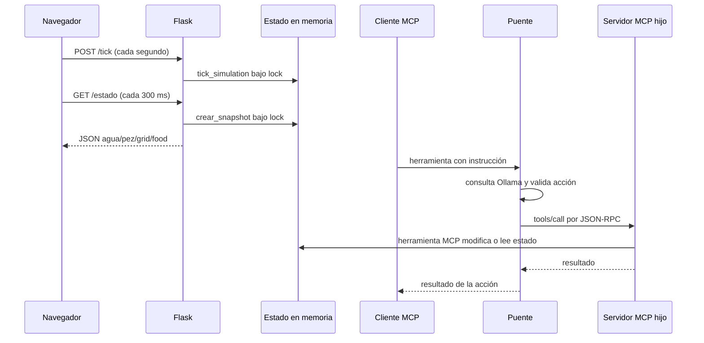

# Flujo de datos

## Modelo de estado

El estado mutable se divide en:

- `STATE`: parámetros del agua, equipos, modo automático, reloj y última
  acción.
- `FISH`: posición, hambre, estrés, salud y supervivencia.
- `FOOD`: porciones en caída o sobre plantas.
- `GRID`: tamaño y posiciones de equipos, plantas y rocas.

Estas estructuras se inicializan en `mcp/fish_tank_server.py:20-43`.
`crear_snapshot()` las agrupa bajo `agua`, `pez`, `grid` y `food`
(`mcp/fish_tank_server.py:98-100`). Las lecturas y escrituras de las
interfaces del servidor se realizan dentro de `lock`; el tick también toma
ese bloqueo (`mcp/fish_tank_server.py:15` y `mcp/fish_tank_server.py:145-149`).

## Ciclo de simulación

`tick_simulation()` ejecuta, en orden general, el reloj y la temperatura, el
hambre y los residuos, el efecto del filtro, oxígeno, nivel de agua y pH,
el modo automático, el estrés y la salud, el consumo o caída del alimento y
el movimiento del pez (`mcp/fish_tank_server.py:145-278`). Si la salud llega a
cero, marca `FISH["alive"]` como falso y termina ese tick
(`mcp/fish_tank_server.py:207-211`).

El monitor genera dos flujos periódicos independientes:

1. Cada segundo hace `POST /tick`, que modifica el estado
   (`mcp/fish_monitor.html:487-489`).
2. Cada 300 ms hace `GET /estado?t=...`, desactiva la caché y pasa el JSON a
   `upd()` (`mcp/fish_monitor.html:491-497`).

`/estado` construye el snapshot bajo el bloqueo y lo devuelve como JSON
(`mcp/fish_tank_server.py:439-445`). `upd()` lee agua, pez, alimento y la
geometría para actualizar indicadores, barras y dibujo del canvas
(`mcp/fish_monitor.html:451-485` y `mcp/fish_monitor.html:416-430`).

## Flujo de lectura MCP

1. Un cliente llama una herramienta MCP o solicita `pecera://estado`.
2. `recurso_estado()` toma el bloqueo y serializa el snapshot completo
   (`mcp/fish_tank_server.py:279-284`).
3. Las herramientas de lectura (`leer_sensores`, `verificar_salud_peces` y
   `medir_calidad_agua`) toman el bloqueo y proyectan partes del estado
   (`mcp/fish_tank_server.py:286-304`, `mcp/fish_tank_server.py:365-380` y
   `mcp/fish_tank_server.py:391-398`).

## Flujo de escritura MCP

Las herramientas mutadoras toman `lock`, cambian `STATE`, `FISH` o `FOOD` y
devuelven texto de resultado. En particular:

- `alimentar()` agrega tres porciones a `FOOD`
  (`mcp/fish_tank_server.py:299-308`).
- `cambiar_temperatura()` actualiza objetivo y calentador
  (`mcp/fish_tank_server.py:310-320`).
- Luz y filtro modifican sus indicadores; limpiar el filtro ajusta química y
  claridad (`mcp/fish_tank_server.py:322-343`).
- `cambiar_agua()` recalcula química, oxígeno, claridad y nivel
  (`mcp/fish_tank_server.py:344-363`).
- `agregar_tratamiento()` modifica valores según el tipo permitido
  (`mcp/fish_tank_server.py:400-421`).
- `activar_auto_cuidar()` cambia `auto_mode` y puede aplicar inmediatamente
  el cuidado automático (`mcp/fish_tank_server.py:423-432`).

El modo automático fuerza condiciones objetivo, enciende filtro y calentador,
ajusta la luz según la hora y puede alimentar cuando corresponde
(`mcp/fish_tank_server.py:122-143`). No existe persistencia en archivos o base
de datos en el código revisado; el estado reside en memoria del proceso.

## Flujo del puente Ollama

El puente recibe una instrucción mediante cualquiera de sus dos herramientas
MCP (`mcp/ollama_bridge.py:360-370`). Luego:

1. Descubre las herramientas del proceso hijo mediante `tools/list` y conserva
   solo el conjunto declarado en `_ACTION_SCHEMAS`
   (`mcp/ollama_bridge.py:188-196`).
2. Envía la instrucción y esos esquemas a Ollama en
   `LLM_BASE_URL/api/chat` (`mcp/ollama_bridge.py:263-289`).
3. Exige como máximo una llamada, valida nombre y argumentos, y rechaza
   nombres, tipos o rangos no permitidos (`mcp/ollama_bridge.py:291-328` y
   `mcp/ollama_bridge.py:330-358`).
4. Envía `tools/call` al servidor hijo y devuelve su contenido
   (`mcp/ollama_bridge.py:198-225`).

El hijo es `fish_tank_server.py`, calculado a partir del directorio del puente
(`mcp/ollama_bridge.py:71-79`). Por tanto, una acción aprobada por el puente
modifica el mismo tipo de estado que una llamada directa al servidor MCP del
proceso hijo; el código no muestra un canal del puente hacia el proceso web
distinto de ese hijo.

## Diagrama de secuencia

El navegador no llama directamente a las herramientas MCP: sus únicas
solicitudes visibles en el código son `/tick` y `/estado`
(`mcp/fish_monitor.html:487-497`).
